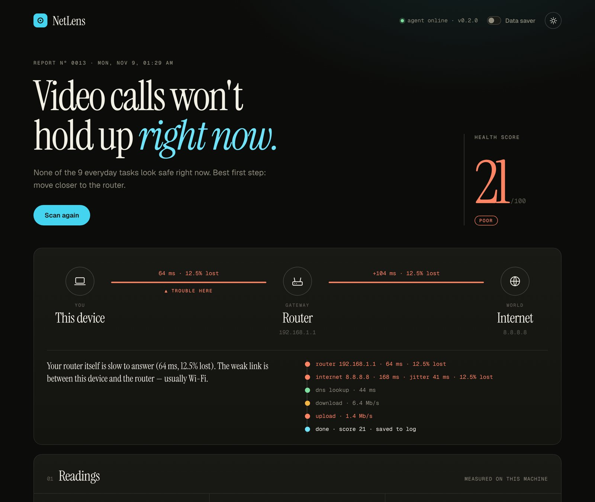

# NetLens

**Will your connection hold up?** NetLens measures your network from your own computer, works out *where* a problem sits (your Wi-Fi or your provider), and tells you in plain words what will work right now: video calls, uploads, streaming, gaming.

It's built for unreliable connections, where "the internet is slow" isn't enough to act on.



<sub>Sample scan with a weak Wi-Fi link.</sub>

## What it does

- **Finds the weak link.** NetLens pings your router and the internet at the same time. If the router itself is slow or dropping packets, the problem is your Wi-Fi. If the router is fine but the internet isn't, the problem is beyond your home, with your provider.
- **Measures what matters.** Latency, jitter, packet loss, DNS lookup time, download and upload speed. Every number is measured, never estimated, and a test that fails says so instead of showing a made-up value.
- **Answers "can I…?"** Nine everyday tasks, each with clear requirements (a video call needs under 150 ms latency, under 2% loss, at least 3 Mb/s up…). Every verdict names the reading that decided it. You can also type your own: *Can I join a Zoom interview right now?*
- **Says what to do next.** Fixes are ranked by where the problem is. Wi-Fi trouble gets "move closer" and "use a cable". Provider trouble gets "restart the router" and "report it to your provider", with steps for each.
- **Keeps a log.** Every scan is stored locally in SQLite. Export it as CSV for evidence when you call your provider.
- **Data saver.** Skips the speed tests (about 13 MB per scan) for metered connections.

## How it works

```
Browser (dashboard) ◀── live progress (server-sent events) ── NetLens agent (FastAPI, on your machine)
                                                                │
                                                                ├─ measure.py   ping router + internet, DNS timing, speed tests
                                                                ├─ analysis.py  rule engine: score, problem location, task verdicts, fixes
                                                                └─ storage.py   SQLite scan log
```

The analysis is a transparent rule engine. One set of thresholds drives the score, the task verdicts and the recommendations, so the different parts of the dashboard never contradict each other. Each rule lives in [`backend/analysis.py`](backend/analysis.py).

| Measurement | How |
|---|---|
| Latency, jitter, packet loss | 8 pings to `8.8.8.8` and 8 to your router, run side by side. Jitter is the mean difference between consecutive round trips. |
| Router address | Read from the system routing table (Windows, macOS, Linux). |
| DNS | Median lookup time for three common domains, as apps on your machine experience it. |
| Download / upload | Timed transfers to `speed.cloudflare.com`, capped at 10 MB / 3 MB or 8 seconds, whichever comes first. |

The speed test is the only thing that talks to an outside service. Everything else stays on your machine.

## Run it

You need Python 3.11 or newer.

**Windows:** double-click `run_agent.bat`, or run:

```bat
run_agent.bat
```

**macOS / Linux:**

```bash
./run_agent.sh
```

The script creates a virtual environment, installs the two dependencies, starts the agent and opens **http://127.0.0.1:8000**.

<details>
<summary>Manual setup</summary>

```bash
python -m venv venv
source venv/bin/activate          # Windows: venv\Scripts\activate
pip install -r backend/requirements.txt
cd backend
uvicorn main:app --host 127.0.0.1 --port 8000
```

</details>

The agent only accepts requests addressed to `127.0.0.1` / `localhost` and rejects cross-site requests, so other websites open in your browser can't start scans or read your results.

## API

| Method | Path | |
|---|---|---|
| `GET` | `/api/v1/scan/stream?throughput=true` | Run a scan, streaming each stage as server-sent events |
| `POST` | `/api/v1/scan?throughput=true` | Run a scan and return the full result |
| `GET` | `/api/v1/scan/latest` | Most recent scan since the agent started |
| `POST` | `/api/v1/check-task` | `{"task": "upload a video"}` → verdict and reason, from the latest scan |
| `GET` | `/api/v1/history?limit=50` | Scan log |
| `GET` | `/api/v1/history.csv` | Scan log as CSV |
| `DELETE` | `/api/v1/history` | Clear the log |

Interactive docs are at http://127.0.0.1:8000/docs while the agent is running.

## Development

```bash
pip install -r backend/requirements-dev.txt
python -m pytest
```

The tests cover ping parsing on Windows (including non-English output), macOS and Linux, router detection, the rule engine, the database migration and the API. CI runs them on all three operating systems.

## Tech stack

Python, FastAPI, SQLite, and a dashboard written in plain HTML, CSS and JavaScript with no build step.
